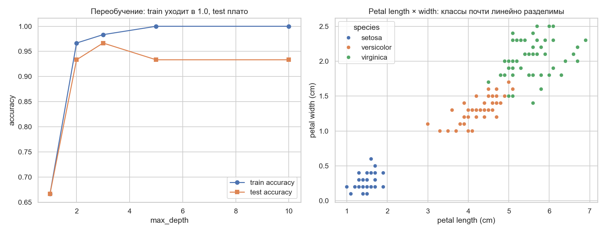

# ЛР1. Git-окружение, pre-commit, EDA варианта 01 (Iris)

**Вариант:** 01
**Работа:** 1
**Дата:** 2026-11-11
**Автор:** Казанцева Е.В.
**Хеш коммита кода:** 62a29abdd9769e3a72f438776691c9ab691223b0
**Хеши данных:** f76795cd108f0cca540638bc47090793842ab3cbff341520b4ab03bb175717e5

## 1. Паспорт данных

- Источник: scikit-learn load_iris (UCI Iris)
- Лицензия: CC0 / public domain
- Объём: 150 строк × 4 признака + target
- Поля: sepal length (cm), sepal width (cm), petal length (cm), petal width (cm), species
- План разбиения: 80/20 stratified, random_state=42

## 2. Сводки EDA

- Пропусков: 0
- Классы: class setosa: 50 (33.3%)
class versicolor: 50 (33.3%)
class virginica: 50 (33.3%)
- Корреляция corr(petal_length, petal_width) = 0.963

## 3. График проблемы варианта

Подпись: при max_depth=10 train accuracy достигает train=1.000, а test — best test accuracy = 0.967;
разрыв  — признак переобучения на малой выборке (150 строк).
Petal length и petal width почти линейно разделяют классы, из-за чего задача
слишком проста и модель легко запоминает данные.

## 4. Негативные контроли

- pre-commit заблокировал 3 случая (см. precommit_block.log, случаи 1–3)
- прямой push в защищённый main заблокирован (см. precommit_block.log, случай 4)
- verify_hash.py при подмене iris.csv выдаёт MISMATCH

## 5. Воспроизводимость

- Повторный прогон eda.py даёт те же eda_stats.csv
- Повтор make_hash_manifest.py даёт тот же JSON

## 6. Выводы (по одному числу на вывод)

1. Объём выборки — 150 строк, этого мало для глубоких моделей.
2. Классы сбалансированы: по 33.3% на класс.
3. Корреляция petal length / width = 0.963 — признак избыточен.
4. При max_depth=10 train=1.000, test=0.967, разрыв — переобучение.
